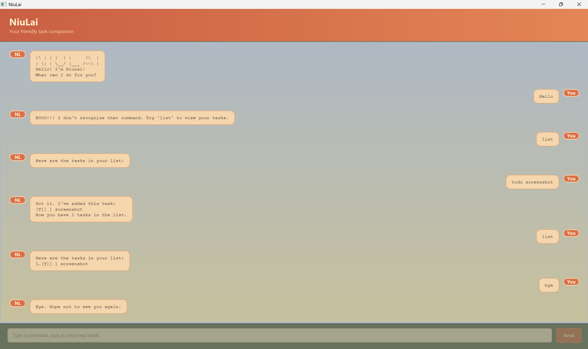

# NiuLai User Guide

NiuLai is a task-management chatbot for keeping track of todos, deadlines, and events. Enter commands to manage your task list; successful task-changing commands are saved automatically.

## Getting started

NiuLai requires Java 25. To start the application:

1. Open the [latest NiuLai release](https://github.com/minghong-dev/ip/releases/latest).
2. Under **Assets**, download `niulai.jar`.
3. Move `niulai.jar` into an empty folder. NiuLai will use this folder to store its data.
4. Open a command window in that folder.
5. Run:

```text
java -jar niulai.jar
```

The NiuLai window will open. Type a command in the box at the bottom, then press `Enter` or click **Send**.



If the command window reports that `java` is not recognized, install JDK 25 and make sure Java is available on your system path. JavaFX native-access or deprecation warnings do not prevent NiuLai from starting.

The examples below show the text displayed inside the GUI conversation.

## Creating tasks

### Adding a todo

Use a todo for a task without a date or time:

```text
todo <description>
```

Example:

```text
todo read book
```

NiuLai adds the todo to the end of the list:

```text
[T][ ] read book
```

### Adding a deadline

Use a deadline for a task that must be completed by a particular date or time:

```text
deadline <description> /by <date or time>
```

Examples:

```text
deadline submit report /by 2026-09-20
deadline return book /by 6pm
```

The `/by` marker is required, and it must appear after the description.

### Adding an event

Use an event for something with a start and end:

```text
event <description> /from <start> /to <end>
```

Example:

```text
event project meeting /from 2026-09-21 10:00 /to 2026-09-21 11:00
```

Both `/from` and `/to` markers are required, in that order. The event must end after it starts when NiuLai can compare the two values.

### Date and time formats

NiuLai recognizes common date and time formats, including:

- Full dates: `2026-09-20` or `20/9/2026`
- Times: `1800`, `18:00`, `6pm`, or `6:30pm`
- Month and day: `June 6th` or `Aug 6th 2pm`

Unrecognized date or time text is kept as entered, so free-form values such as `tomorrow` are also supported for deadlines and events.

## Viewing tasks

### Listing all tasks

Use `list` to display every task in its current order:

```text
list
```

Each task is shown with a one-based task number. For example:

```text
1.[T][ ] read book
2.[D][ ] submit report (by: Sep 20 2026)
```

The symbols show the task type and status:

| Symbol | Meaning |
| --- | --- |
| `[T]` | Todo |
| `[D]` | Deadline |
| `[E]` | Event |
| `[ ]` | Not completed |
| `[X]` | Completed |

### Finding tasks by keyword

Use `find <keyword>` to search task descriptions. The search is case-insensitive and keeps the original task numbers:

```text
find book
```

This finds descriptions such as `read book` and `return book`.

### Finding tasks by date

Use an ISO date in `yyyy-mm-dd` format to find deadlines and events occurring on that date:

```text
find 2026-09-20
```

Todos without dates are not included in a date search. The date search also keeps each matching task's original task number.

## Managing tasks

Use the task number shown by `list` with these commands:

| Command | Format | What it does |
| --- | --- | --- |
| Mark as done | `mark <task number>` | Marks a task as completed. |
| Mark as not done | `unmark <task number>` | Returns a completed task to pending. |
| Delete | `delete <task number>` | Removes a task from the list. |

Examples:

```text
mark 1
unmark 1
delete 2
```

Task numbers start at `1`. If tasks are added or deleted, run `list` again before using a number so that you are working with the current list.

## Undoing a change

Use `undo` to reverse the most recent successful task-changing command:

```text
undo
```

NiuLai can undo one change at a time. This includes adding, marking, unmarking, or deleting a task. Commands such as `list` and `find` do not change the task list, so they do not replace the change available to undo. If there is no successful change to reverse, NiuLai reports that there is nothing to undo.

## Ending a session

Use `bye` to exit NiuLai:

```text
bye
```

Tasks are saved automatically after successful task-list changes and loaded again the next time NiuLai starts. The default data file is `data\niulai.txt`, relative to the folder from which the application is run.

## Quick reference

| Command | Usage |
| --- | --- |
| `todo` | `todo <description>` |
| `deadline` | `deadline <description> /by <date or time>` |
| `event` | `event <description> /from <start> /to <end>` |
| `list` | `list` |
| `find` | `find <keyword>` or `find <yyyy-mm-dd>` |
| `mark` | `mark <task number>` |
| `unmark` | `unmark <task number>` |
| `delete` | `delete <task number>` |
| `undo` | `undo` |
| `bye` | `bye` |

If a command is malformed or refers to a task number that does not exist, NiuLai displays an error and leaves the task list unchanged.

## Developer launch options

Developers working from the project source can launch the JavaFX GUI from the project root:

```powershell
.\gradlew.bat run
```

To run the command-line interface instead, open `src/main/java/niulai/NiuLai.java` in IntelliJ IDEA and run `NiuLai.main()`.
